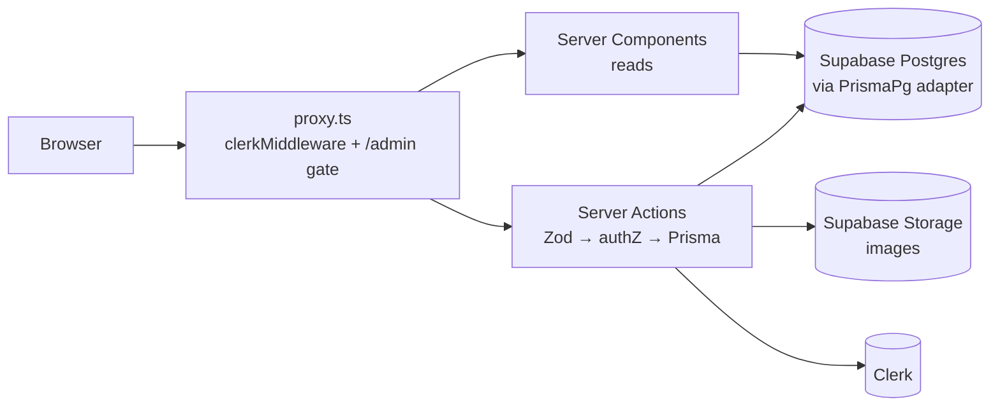

<div align="center">

# 🍽️ Food Menu · Full-Stack E-Store

**A full-stack commerce app with no separate backend. Next.js 16 Server Actions talk straight to
Postgres through Prisma 7, with Clerk auth and Supabase Storage for media.**


</div>

---

## Overview

This project runs the whole stack in **one Next.js codebase**. React Server Components read from
Postgres, and every write is a **Server Action** validated with **Zod**. Each action is authorized
against the Clerk session and persisted with **Prisma 7 + the `pg` driver adapter** over Supabase's
connection pooler.

## Features

- 🍔 **Catalog.** Featured items, categories, case-insensitive search, product pages with reviews
- ❤️ **Favorites.** Per-user and ownership-scoped
- 🛒 **Cart.** Totals are recalculated from *current* DB prices on every view, so the client can't tamper with prices
- 📦 **Orders.** Cart checkout runs in a **single DB transaction** (create orders + clear cart), or “buy now” for one item
- ⭐ **Reviews.** 1–5 stars. The author's name and avatar come from Clerk on the server
- 🧑‍💼 **Admin.** Product & category CRUD, image upload/replace with old-file cleanup, and all orders

## Architecture



```
app/                 # (root) storefront · (dashboard) admin · (auth) Clerk pages
prisma/schema.prisma # Product · Category · Cart · CartItem · Order · Favorite · Review
utils/
├── actions.ts       # every Server Action: validate → authorize → query
├── schema.ts        # Zod schemas (product, category, review, image, id, cart amount)
├── db.ts            # Prisma singleton (hot-reload safe) with the pg adapter
└── supabase.ts      # storage upload/delete
```

## Security model

Every export of a `"use server"` file is a **public HTTP endpoint**, and this codebase is written with that in mind:

| Threat | Mitigation |
| --- | --- |
| Non-admin calling admin actions | Each mutating admin action calls `getAdminUser()` *first*. The proxy check is just a second layer |
| IDOR on favorites / cart lines | Deletes and updates are scoped with `clerkId` / `cartId` in the `where` clause |
| Calling internal helpers directly | Cart helpers that take a `userId` are module-private. Pages use `fetchUserCart()`, which derives the user from the session |
| Price / quantity tampering | Amounts are validated as integers from 1 to 100, and totals are always recomputed from DB prices |
| Arbitrary file deletion | The image being replaced is read from the DB, never from a hidden form field |
| Stored XSS through uploads | Raster-image MIME allow-list (no SVG), 1 MB cap, server-generated random filenames |
| Review impersonation | `authorName` / `authorImageUrl` are set from the Clerk user on the server |
| Leaking DB internals | Prisma errors are logged on the server and the user gets a generic message |
| Partial writes | Checkout uses `prisma.$transaction` |
| Clickjacking, MIME sniffing, downgrade | HSTS, `X-Frame-Options: DENY`, `nosniff`, `Referrer-Policy`, `Permissions-Policy` |

## Getting started

```bash
git clone https://github.com/n1j10/Food-Menu.git
cd Food-Menu
npm install                 # postinstall runs `prisma generate`
cp .env.example .env
npx prisma migrate deploy   # uses DIRECT_URL
npm run dev
```

| Variable | Description |
| --- | --- |
| `DATABASE_URL` | Supabase **transaction** pooler (runtime) |
| `DIRECT_URL` | Supabase **session** pooler (Prisma CLI / migrations) |
| `SUPABASE_URL`, `SUPABASE_KEY` | Storage bucket for images |
| `NEXT_PUBLIC_CLERK_PUBLISHABLE_KEY`, `CLERK_SECRET_KEY` | Clerk |
| `ADMIN_USER_ID` | Clerk user id allowed to administer the store |
| `NEXT_PUBLIC_WEBSITE_URL` | Canonical URL for share links |

| Command | Purpose |
| --- | --- |
| `npm run dev` | Dev server |
| `npm run build` | `prisma generate` + production build |
| `npx prisma studio` | Browse the database |
| `npx tsc --noEmit` | Type-check |

## Tech stack

**Framework** Next.js 16 · React 19 · TypeScript · Server Actions
**Data** Prisma 7 (`@prisma/adapter-pg`) · Supabase Postgres · Supabase Storage
**Auth** Clerk · **Validation** Zod 4
**UI** Tailwind CSS v4 · shadcn/ui · Base UI · Embla · Sonner

Deployed on **Vercel**.

---

<div align="center">

Built by **[n1j10](https://github.com/n1j10)**

</div>
